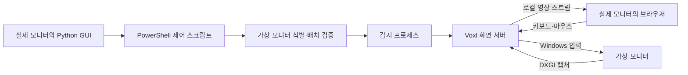

# browsed-local

Windows의 **가상 모니터를 브라우저에서 보고 조작**하는 로컬 도구입니다. 작은 데스크톱 GUI로 화면 서버를 켜고 끄고, 브라우저를 열고, 접속 비밀번호를 복사합니다.

같은 PC에서 자기 화면을 브라우저로 열면 화면 속에 같은 화면이 계속 반복됩니다. browsed-local은 실제 모니터에 브라우저와 제어창을 두고, **별도의 가상 모니터만 송출**하여 이 문제를 피합니다. Codex 등의 브라우저 조작 도구도 이 페이지를 통해 가상 모니터의 앱을 조작할 수 있습니다.

> Windows용 소스·GUI 패키지입니다. Python, PowerShell, Voxl과 서명된 가상 디스플레이 드라이버는 별도 준비가 필요합니다. Mac/Linux 호스트와 여러 PC를 모으는 대시보드는 포함하지 않습니다.

## GUI

| 표시 / 버튼 | 동작 |
| --- | --- |
| 켜짐 · 꺼짐 · 확인 오류 | 서버 상태를 주기적으로 확인 |
| 켜기 | 검증한 가상 모니터로 화면 서버 실행 |
| 끄기 | 이 패키지가 실행하고 소유권을 확인한 서버만 종료 |
| 화면 열기 | `http://127.0.0.1:16901/` 접속 |
| 비밀번호 복사 | 로컬 자격증명 파일에서 읽어 클립보드에 복사 |

제어창을 닫아도 서버는 계속 실행됩니다. **끄기**는 화면 서버만 종료하며, 가상 모니터를 제거하거나 비활성화하지 않습니다. 로그인 창의 계정에는 `codex`, 비밀번호에는 복사한 값을 입력합니다. `codex`는 Windows 계정을 생성하는 기능이 아닙니다.

## 준비

- Windows 10/11 x64의 로그인된 데스크톱 세션. 실제 검증 환경은 Windows 11 x64입니다.
- [Python 3.13](https://www.python.org/downloads/windows/)과 Tkinter. `python -m tkinter`로 확인합니다. pip 패키지는 필요 없습니다.
- [PowerShell 7](https://learn.microsoft.com/powershell/scripting/install/installing-powershell-on-windows). `pwsh`가 PATH에 있어야 합니다.
- [Voxl v0.3.3](https://github.com/tembo/voxl/tree/47bb94ec4d253638c1470eb81906676e1bef4b00)의 Windows 실행 파일. [준비 방법](docs/DEPENDENCIES.md)을 참고하세요.
- [Virtual Display Driver 25.7.23](https://github.com/VirtualDrivers/Virtual-Display-Driver/releases/tag/25.7.23)의 서명된 드라이버. 공식 설치 도구로 설치합니다. browsed-local은 드라이버를 자동 설치하지 않습니다.

현재 지원하는 배치는 **실제 주 모니터 1개 + 가상 모니터 1개**입니다. Windows 디스플레이 설정에서 확장 모드를 선택하고, 실제 화면을 주 모니터와 원점 `(0,0)`에 유지합니다. 가상 화면은 실제 화면 바로 오른쪽, 위쪽 정렬, **1920×1080 / 60 Hz**로 설정합니다. 복제 모드는 사용하지 않습니다. 서버 실행 중 배치·해상도·주 모니터를 바꾸면 서버가 종료될 수 있습니다.

## 설치와 실행

저장소를 복제하거나 [릴리스 ZIP](https://github.com/zenovis2-create/browsed-local/releases)을 풀고, 해당 폴더에서 실행합니다. 경로 예시의 `C:\Tools\voxl\voxl.exe`는 자신이 준비한 파일로 바꾸세요.

```powershell
# 쓰기 없이 의존성·디스플레이 배치 확인
pwsh -NoProfile -File .\scripts\setup.ps1 -VoxlPath 'C:\Tools\voxl\voxl.exe' -CheckOnly

# 이 PC의 실행 파일 해시와 화면 식별 정보 등록
pwsh -NoProfile -File .\scripts\setup.ps1 -VoxlPath 'C:\Tools\voxl\voxl.exe'

# 바탕화면과 시작 메뉴에 browsed-local 바로가기 생성
pwsh -NoProfile -File .\windows\control-panel\install-shortcuts.ps1
```

바탕화면의 **browsed-local**을 더블클릭하고 **켜기 → 비밀번호 복사 → 화면 열기** 순서로 사용합니다. 바로가기 없이 실행하려면:

```powershell
pythonw .\windows\control-panel\virtual_screen_control.pyw
```

제어창과 브라우저는 실제 모니터에 두고, 조작할 앱을 가상 모니터로 이동하세요. `Win+Shift+←/→`로 앱 창을 다른 모니터로 옮길 수 있습니다. 가상 모니터 안에 자신의 접속 브라우저를 이동하면 다시 화면이 반복될 수 있습니다.

## 작동 원리



GUI는 백그라운드 작업으로 PowerShell을 호출하고 응답 파일로 결과를 받습니다. 서버 감시 프로세스가 오래 살아 있어도 GUI가 대기 상태에 갇히지 않도록, 자식 프로세스가 상속할 수 있는 표준 출력 파이프를 결과 전달에 쓰지 않습니다. 감시 프로세스는 약 2초 간격으로 가상 화면을 다시 확인합니다. 자세한 설계는 [ARCHITECTURE.md](docs/ARCHITECTURE.md)에 있습니다.

## 로컬 데이터와 범위

첫 서버 실행 시 무작위 비밀번호가 생성되며 `windows/credentials.json`에 현재 사용자·SYSTEM·Administrators만 접근하도록 ACL을 설정합니다. 비밀번호를 명령행 인수, GUI 텍스트, 로그에 출력하지 않습니다. 비밀번호 복사 버튼을 누르면 시스템 클립보드에는 들어갑니다.

설정, 자격증명, PID, 화면 식별 정보, 공유 폴더는 Git에서 제외합니다. 화면 서버는 `127.0.0.1:16901`에만 바인딩합니다. 이 버전은 인터넷 공개, TLS 프록시, 다른 PC 접속 설정을 제공하지 않습니다. 오디오·마이크와 브라우저 클립보드 동기화는 비활성화합니다. 가상 모니터는 같은 Windows 로그인 세션에 속하므로 독립 VM이나 별도 사용자 세션이 아니며, 키보드·마우스 포커스를 실제 작업과 공유합니다.

## 검증과 문제 해결

```powershell
pwsh -NoProfile -File .\scripts\verify.ps1
```

이 검증은 구문·회귀 테스트를 실행하며 드라이버나 화면 배치를 변경하지 않습니다. 실제 화면 캡처·인증 검증은 서버를 켠 뒤 `pwsh -NoProfile -File .\windows\status.ps1`로 수행합니다. [검증 범위와 제한](docs/VALIDATION.md), [문제 해결](docs/TROUBLESHOOTING.md)을 참고하세요.

## 라이선스

browsed-local의 소스는 [MIT](LICENSE)입니다. Voxl과 Virtual Display Driver는 별도 프로젝트이며 실행 파일·드라이버를 이 저장소에 재배포하지 않습니다. 출처와 버전은 [THIRD_PARTY.md](THIRD_PARTY.md)에 정리되어 있습니다.
